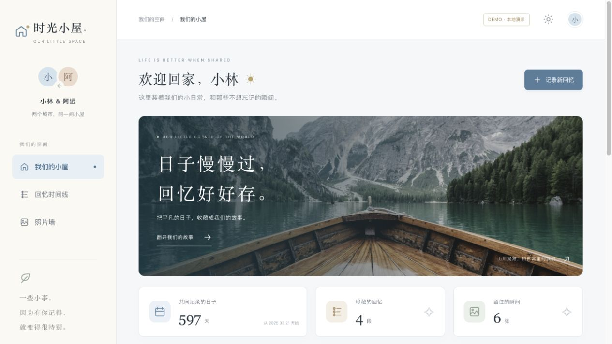
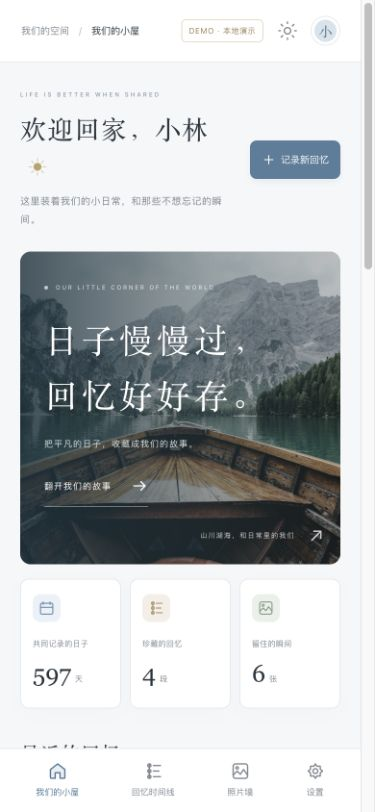

# 时光小屋 · Our Little Space

**一个从产品设计、前端交互到数据库权限与云端部署的全栈项目实践。**

面向两位朋友或伴侣的私密回忆空间：保存文字和照片、按时间浏览、留言互动；不同用户可以建立各自独立的双人小屋。

[免登录体验界面](https://our-little-space-d9evhay4626495b-1526450049.tcloudbaseapp.com/demo/) · [进入云端测试站](https://our-little-space-d9evhay4626495b-1526450049.tcloudbaseapp.com/) · [技术复盘](docs/CASE_STUDY.md) · [验收与复现](docs/VALIDATION.md) · [自行部署](DEPLOYMENT.md)

> `/demo` 使用虚构数据，存储在当前浏览器，不会联网同步。云端体验需要独立账号。代码采用 AI 辅助开发，具体参与方式见下文。

## 产品效果



<details>
<summary>查看手机尺寸演示</summary>



</details>

截图为本地演示页面，均不包含用户私人内容；移动端截图不代表 iPhone 真机拍照验收。

## 这个项目解决什么问题

两个人身处不同城市，需要一个共同收藏日常的空间。除展示页面外，项目实现了独立身份、小屋成员关系、照片私有访问和作者权限控制，并处理跨设备更新及上传失败重试。

- **产品与前端**：响应式布局、时间线、照片墙、表单与反馈、深浅主题；搜索关键词和月份，适配桌面与手机导航。
- **业务与数据**：注册、邮箱验证、创建小屋、指定邮箱邀请、两人上限、接受/撤销邀请、撤销成员。
- **内容与互动**：回忆编辑、多图压缩上传、私有照片预览、评论、表情回应、昵称头像、授权数据导出。
- **工程实践**：云服务适配边界、PostgreSQL RLS、上传重试、回归测试、静态构建和国内云服务部署。

## 值得查看的技术实现

| 问题 | 实现与取舍 | 可核查的代码/测试 |
| --- | --- | --- |
| 不同小屋如何互相隔离？ | 数据库 RLS 按有效成员授权；照片私有桶也检查成员及路径身份 | [权限迁移](cloudbase/migrations/202611060001_private_space.sql)、[权限测试](cloudbase/tests/rls.test.mjs) |
| 邀请怎样避免邮箱不匹配、超员？ | 服务端核验已验证邮箱、有效期与成员关系；事务锁处理成员变更 | [邀请函数](cloudbase/migrations/202611060003_username_profile.sql) |
| 上传成功但响应丢失怎么办？ | 稳定 UUID 作为重试标识，检查已有记录，保留批次中已成功项 | [上传逻辑](src/lib/cloud/reliability.ts)、[回归测试](src/lib/cloud/reliability.test.ts) |
| 云服务迁移后为什么保存报错？ | 对已解码 JSON 重新构造标准 Response，修复 UUID 标量解析 | [响应适配](src/lib/cloud/response.ts)、[测试](src/lib/cloud/response.test.ts) |
| 大整数账号标识怎样避免精度丢失？ | UID 始终保留字符串，拒绝数字身份格式 | [会话边界](src/lib/cloud/session.ts)、[测试](src/lib/cloud/session.test.ts) |
| 两种私有照片 API 如何兼容？ | 统一签名链接字段，拒绝错误项与非 HTTPS 地址 | [签名链接解析](src/lib/cloud/photo-url.ts)、[测试](src/lib/cloud/photo-url.test.ts) |

更完整的背景、方案和限制见 [项目复盘](docs/CASE_STUDY.md)。没有经过测量的并发量、用户规模和性能指标不作承诺。

## 架构与技术栈

| 层次 | 技术与职责 |
| --- | --- |
| 页面与交互 | Next.js App Router、React、TypeScript、Tailwind CSS |
| 业务接口 | 统一认证/数据调用边界，业务界面复用 |
| 国内服务 | CloudBase 上海 PostgreSQL、身份认证、私有存储、静态托管 |
| 另一部署路径 | Supabase Auth、PostgreSQL、Storage 与 Vercel |
| 测试 | Node 内置测试运行器；PGlite 执行隔离的 PostgreSQL 权限测试 |

国内版采用每 10 秒轮询、窗口聚焦/联网刷新；Supabase 版支持事件订阅与刷新兜底。照片使用 120 秒签名链接。当前没有 service worker，不是完整 PWA；没有付费 AI API。

## 开发方式与个人参与

作者提出产品目标、视觉偏好、国内访问与免费部署约束，参与浏览器/手机试用反馈和云账号授权操作。代码实现、调试和文档整理使用 Codex 辅助。

这是持续学习和迭代的项目。个人掌握程度应结合本人对设计取舍、关键代码与测试的讲解判断；仓库保留实现和验证证据，便于复现与讨论。

## 当前验证状态

- **逻辑测试**：26 项；覆盖搜索、日期、重试、会话、JSON 响应、私有链接、邮箱验证与注册输入。
- **数据库权限测试**：CloudBase 18 组场景、Supabase 17 组场景，使用本地隔离 PostgreSQL 引擎。
- **真实国内服务已验证**：已有账号登录与邮箱验证、建屋、测试回忆/照片/留言读写、同账号另一页面定时更新。
- **仍待验收**：新邮箱自助注册至建屋与邀请的完整流程、国内两个独立账号共享、iPhone 真机拍照、跨网络及撤权体验。

自动化测试不等于全部线上流程通过。详细验证范围与后续检查见 [验收记录](docs/VALIDATION.md)。

## 本地运行与测试

需要 Node.js 22.18+（当前本机验证环境为 Node.js 23.11）及 npm。

```sh
npm ci
cp .env.example .env.local
npm run dev
```

未填写云配置时使用本地演示；`/demo` 始终是浏览器本地模式。部署自己的云环境参考 [部署说明](DEPLOYMENT.md)，不要提交 `.env.local`。

```sh
npm test
npm run test:cloudbase
npm run test:rls
npm run build
npm run typecheck
```

## 在线测试服务的使用时间

当前腾讯云免费环境有效期至 **2027 年 5 月 6 日（北京时间）**。这不是持续可用至该日的承诺，也不承诺自动续期或永久免费。

每月 3,000 资源点由所有测试用户共用；额度用尽、维护、网络或平台限制可能导致暂停。平台测试域名可能显示访问提示。请定期在“小屋设置 → 导出授权数据”备份，不将测试站作为重要照片的唯一副本。

## 后续计划

1. 完成新账号全流程、双设备与撤权验收。
2. 补充密码恢复、账号注销、服务端防滥用配额和分页加载。
3. 测量轮询成本与大相册性能，再评估 PWA、导入和离线上传。

## 安全、贡献与许可

详见 [安全说明](SECURITY.md)。欢迎 Issue 和 PR，请勿提交私人回忆、验证码或密钥。代码采用 [MIT License](LICENSE)；演示照片适用独立的 [Unsplash 素材许可](ASSETS.md)。
